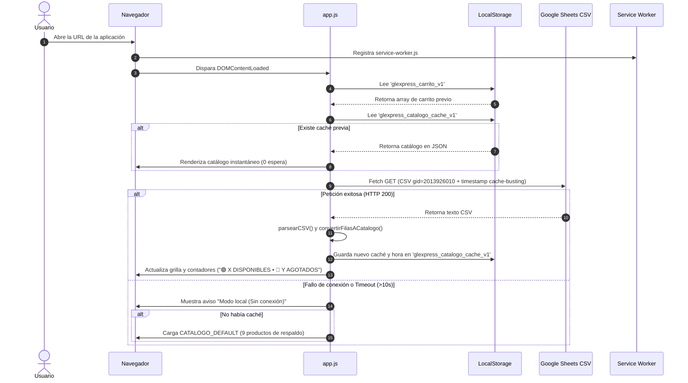
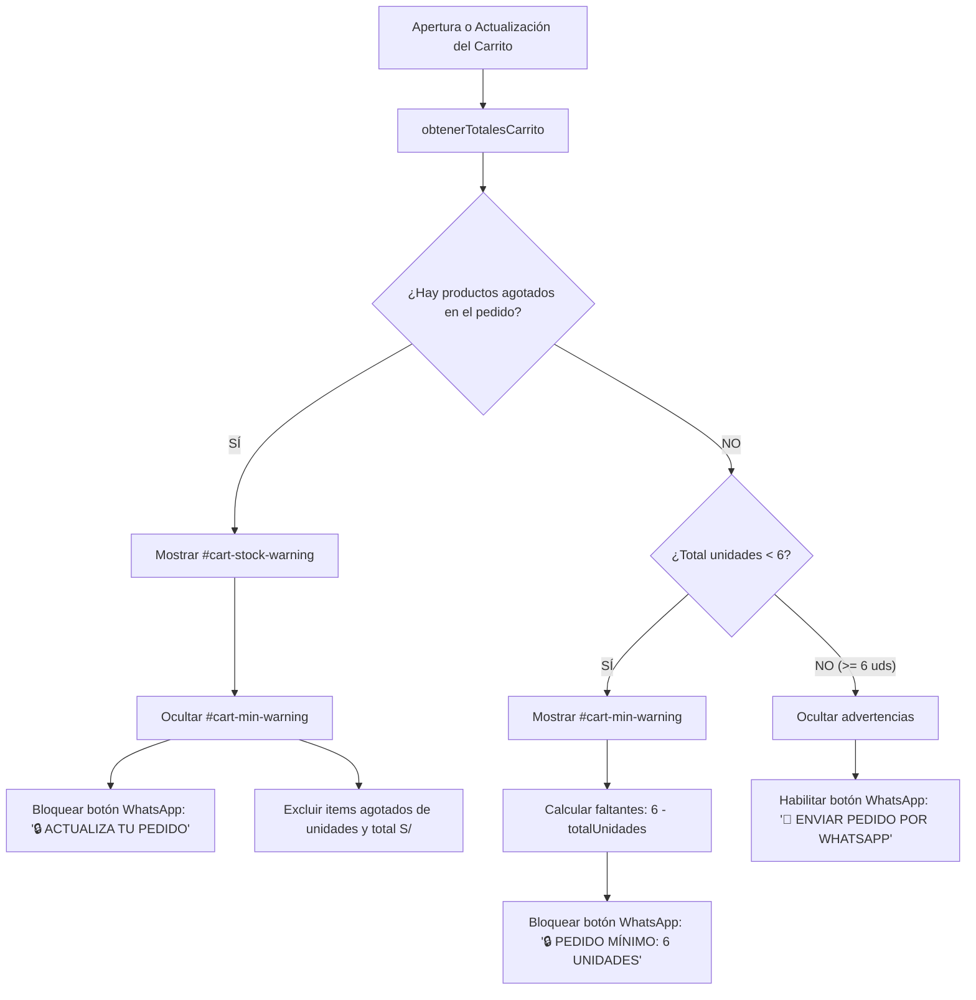

# 03 — Funcionamiento y Flujos del Sistema

> **Archivo:** `ANALISIS-PARA-CHAT-GPT/03-FUNCIONAMIENTO-Y-FLUJOS.md`  
> **Clasificación general:** CONFIRMADO EN CÓDIGO (Rastreo de flujos en `app.js` y `index.html`)

---

## 1. Resumen de Flujos Implementados vs. No Implementados

| Funcionalidad / Flujo | Estado de Implementación | Observación Técnica |
| :--- | :--- | :--- |
| **Carga y navegación del catálogo** | **COMPLETO** | Sincronización automática con Google Sheets y renderizado en grilla |
| **Búsqueda en tiempo real** | **COMPLETO** | Búsqueda insensible a mayúsculas y diacríticos (`app.js:1092-1154`) |
| **Filtros por categoría, género y estado** | **COMPLETO** | Filtros combinables con indicador visual de filtros activos |
| **Detalle individual de producto** | **NO APLICA / COMPACTO**| No existe vista ni modal de detalle individual; la tarjeta contiene todo |
| **Precios y reglas mayoristas** | **COMPLETO** | Muestra exclusivamente "PUESTO EN PERÚ"; oculta precios y costos USA |
| **Validación de pedido mínimo (6 unidades)**| **COMPLETO** | Bloqueo estricto del botón de WhatsApp y alerta dinámica de faltantes |
| **Validación de productos agotados** | **COMPLETO** | Bloqueo preventivo en carrito si un item sincronizado pasa a agotado |
| **Carrito mayorista** | **COMPLETO** | Selector stepper en tarjeta y modal, cálculo de subtotales y totales |
| **Envío a WhatsApp** | **COMPLETO** | Generador y codificador URL de mensaje estandarizado |
| **Nombre del cliente en pedido** | **PARCIAL / INCONSISTENTE**| `app.js` intenta leer `#input-cliente-nombre`, pero el input no está en el HTML |
| **Inicio / Cierre de sesión** | **NO EXISTE (POR DISEÑO)**| Aplicación de acceso público y directo, sin usuarios ni contraseñas |
| **Panel administrativo** | **NO EXISTE (POR DISEÑO)**| La administración de inventario y precios se hace en Google Sheets |
| **Descuentos por volumen adicionales** | **NO IMPLEMENTADO** | Precio unitario fijo por fila; no hay escalas de precios 6-12-24 |

---

## 2. Detalle Paso a Paso de los Flujos de Usuario

### Flujo 1: Arranque y Carga del Catálogo



- **Acción del usuario:** El usuario ingresa a la aplicación.
- **Código ejecutado:** `app.js:1450-1452` ejecuta `cargarCarrito()` y `cargarCatalogo(false)`.
- **Validaciones:**
  - Control de concurrencia: si `catalogoCargando === true`, aborta peticiones paralelas.
  - AbortController con temporizador de 10 segundos (`app.js:1205-1213`).
- **Fuentes / Destinos de datos:** Lee `localStorage` y luego el endpoint de Google Sheets.
- **Resultado:** Interfaz disponible de inmediato sin pantalla en blanco; catálogo actualizado si hay internet.

---

### Flujo 2: Búsqueda y Filtrado de Perfumes

- **Acción del usuario:**
  - El usuario escribe en `#catalogo-busqueda`, o
  - Pulsa un botón de categoría (*Diseñador* / *Árabes*), género (*Hombre* / *Mujer*) o estado (*Disponibles* / *Agotados*).
- **Código ejecutado:**
  - Se invoca `filtrarCatalogo()` en `app.js:1092-1154`.
  - Normaliza cadenas eliminando acentos mediante `.normalize('NFD').replace(/[\u0300-\u036f]/g, '').toLowerCase()`.
- **Lógica de negocio aplicada:**
  1. **Búsqueda por texto:** Compara si el término normalizado está contenido en el nombre del perfume.
  2. **Filtro Categoría:** Coincidencia con palabras clave (`disenad`, `arab`).
  3. **Filtro Género con Regla Unisex:** Si el filtro es "Hombre", incluye perfumes masculinos Y unisex. Si es "Mujer", incluye perfumes femeninos Y unisex (`app.js:1130-1142`).
  4. **Filtro Estado:** Discrimina según `item.esAgotado === true` o `false`.
- **Resultado:**
  - Si hay coincidencias: Renderiza las tarjetas coincidentes y actualiza el contador `#catalogo-contador-resultados` ("N perfumes encontrados").
  - Si no hay coincidencias: Oculta la grilla y despliega `#catalogo-empty` con textos contextuales según el filtro o término ingresado (`app.js:913-926`).

---

### Flujo 3: Selección de Cantidad y Agregado al Pedido

- **Acción del usuario:**
  - En la tarjeta del producto, pulsa `+` o `-` para cambiar las unidades (por defecto `1`).
  - Pulsa el botón "🛒 Agregar".
- **Código ejecutado:**
  - Pulsar stepper: Modifica `localCardQuantities[productoId]` y actualiza el texto del elemento `#stepper-val-${productoId}` (`app.js:1001-1020`). No altera el carrito aún.
  - Pulsar Agregar: Invoca `agregarAlPedido(productoId)` en `app.js:436-470`.
- **Validaciones:**
  - Si `producto.esAgotado === true`, aborta y emite toast informativo ("Este producto se encuentra agotado").
  - Cantidad mínima seleccionable en tarjeta: 1 unidad.
- **Operación de datos:**
  - Si el item ya existía en el carrito: `itemExistente.cantidad += cantidadSeleccionada`.
  - Si es nuevo: Inserta objeto `{ id, producto, precioUSA, puestoPeru, imagen, cantidad, subtotal }`.
  - Recalcula subtotal: `subtotal = Math.round((cantidad * puestoPeru + Number.EPSILON) * 100) / 100`.
  - Resetea el stepper de la tarjeta a `1`.
  - Invoca `guardarCarrito()` -> guarda JSON en `localStorage.setItem('glexpress_carrito_v1', ...)`.
- **Resultado:**
  - El contador de la cabecera (`#header-cart-count`) se incrementa.
  - La barra flotante inferior (`#floating-cart-bar`) aparece mostrando el total de unidades y soles.
  - Se muestra un toast temporal: `✅ Agregado: Nx [Nombre del Perfume]`.

---

### Flujo 4: Gestión del Carrito y Reglas de Negocio en Modal

- **Acción del usuario:** Pulsa el botón del carrito en el header o la barra flotante "Ver pedido".
- **Código ejecutado:** `abrirModalCarrito()` -> `renderizarModalCarrito()` (`app.js:519-634`).
- **Comportamiento en pantalla:**
  - Despliega el modal `#modal-carrito` ocupando el 95% de la altura de la pantalla (`95vh`).
  - Bloquea el scroll del fondo del cuerpo (`document.body.style.overflow = 'hidden'`).
  - La lista central de items tiene scroll independiente, manteniendo siempre a la vista el header y el resumen de totales inferior.

#### Reglas de Validación Comercial Evaluadas:



1. **Regla de Prioridad 1: Detección de Agotados en Carrito (`hayAgotados`):**
   - Si un usuario agregó un perfume y posteriormente la sincronización de Google Sheets lo marcó como agotado:
     - El item se pinta con borde rojo y badge `AGOTADO` (`.is-item-agotado`).
     - **Los items agotados NO suman al total de unidades ni al importe en soles del pedido** (`app.js:320-327`).
     - Se muestra la alerta `#cart-stock-warning` ("Algunos productos de tu pedido ya no están disponibles. Elimina los productos agotados para continuar.").
     - Se deshabilita el botón de WhatsApp con el texto: `🔒 ACTUALIZA TU PEDIDO`.
2. **Regla de Prioridad 2: Pedido Mínimo Mayorista de 6 Unidades (`MIN_UNIDADES_MAYORISTA`):**
   - Definido en constante: `const MIN_UNIDADES_MAYORISTA = 6;` (`app.js:132`).
   - Si no hay agotados pero el total de unidades disponibles es menor a 6:
     - Se muestra la alerta `#cart-min-warning`.
     - Texto dinámico `#cart-min-remaining-text`: `Te faltan X unidades para confirmar.`
     - Botón de WhatsApp deshabilitado con texto: `🔒 PEDIDO MÍNIMO: 6 UNIDADES`.
3. **Estado Habilitado:**
   - Si `totalUnidades >= 6` y `hayAgotados === false`:
     - Se ocultan las alertas.
     - Botón de WhatsApp activo con estilo verde: `📲 ENVIAR PEDIDO POR WHATSAPP`.

---

### Flujo 5: Checkout y Envío a WhatsApp

- **Acción del usuario:** Pulsa el botón habilitado `📲 ENVIAR PEDIDO POR WHATSAPP`.
- **Código ejecutado:** `enviarPedidoWhatsApp()` en `app.js:651-698`.
- **Validaciones en tiempo de ejecución:**
  1. Si `carrito.length === 0`: Toast "Tu pedido está vacío".
  2. Si `validarProductosDisponibles().esValido === false`: Toast de error y rechaza el envío.
  3. Si `totalUnidades < MIN_UNIDADES_MAYORISTA`: Toast de error y rechaza el envío.
- **Construcción del mensaje:**
  - Extrae `nombreCliente` desde `elements.inputClienteNombre`.
    > ⚠️ **Hallazgo crítico:** Dado que el elemento `#input-cliente-nombre` **no existe** en `index.html`, la variable siempre se resuelve en una cadena vacía `""`.
  - El formato del mensaje generado es estrictamente:
    ```text
    PEDIDO MAYORISTA GL EXPRESS

    Cliente: [vacío actualmente]

    1 x 9 Am Dive 3.4 Oz Edp Unisex
    Precio: S/90.00
    Subtotal: S/90.00

    5 x Club de Nuit Intense Man EDT 105ml
    Precio: S/115.00
    Subtotal: S/575.00

    TOTAL UNIDADES: 6
    TOTAL PEDIDO: S/665.00
    ```
- **Disparo de la conexión:**
  - Codifica el mensaje con `encodeURIComponent(mensaje)`.
  - Construye la URL:
    `https://api.whatsapp.com/send?phone=51910487554&text=PEDIDO%20MAYORISTA%20GL%20EXPRESS...`
  - Ejecuta `window.open(urlWhatsApp, '_blank')`, abriendo la app de WhatsApp o WhatsApp Web en el dispositivo del cliente.

---

### Flujo 6: Vaciado del Pedido con Confirmación

- **Acción del usuario:** Dentro del carrito, pulsa "🗑️ Vaciar pedido".
- **Código ejecutado:**
  1. `solicitarVaciarPedido()` abre el modal `#modal-confirmar-vaciar`.
  2. Si el usuario pulsa "Cancelar" o presiona la tecla `Escape`: el modal se cierra y el carrito queda intacto.
  3. Si el usuario pulsa "🗑️ Vaciar carrito": ejecuta `vaciarPedido()` (`app.js:510-517`), asignando `carrito = []`, limpiando `glexpress_carrito_v1` en `localStorage`, cerrando ambos modales y emitiendo un toast "Pedido vaciado".

---

## 3. Localización de Cálculos Financieros y Validaciones

| Importe / Validación | Dónde se calcula | Archivo y Función | Existencia Servidor |
| :--- | :--- | :--- | :--- |
| **Precio Unitario (Puesto en Perú)** | En Google Sheets (Columna J) | Leído en `app.js:852` | En Google Sheets (remoto) |
| **Subtotal por Producto** | En el navegador (Cliente) | `app.js:448, 457, 480` | **No existe en servidor** |
| **Total de Unidades** | En el navegador (Cliente) | `app.js:305-338` (`obtenerTotalesCarrito`) | **No existe en servidor** |
| **Total en Soles del Pedido** | En el navegador (Cliente) | `app.js:305-338` (`obtenerTotalesCarrito`) | **No existe en servidor** |
| **Validación de Pedido Mínimo (6)** | En el navegador (Cliente) | `app.js:400-434, 668-673` | **No existe en servidor** |
| **Validación de Disponibilidad** | En el navegador (Cliente) | `app.js:291-303, 658-663` | **No existe en servidor** |

> **Implicación de Arquitectura:** Al tratarse de un modelo sin backend transaccional, todas las validaciones de negocio (pedido mínimo, exclusión de agotados y totales) residen en el JavaScript del cliente. La verificación final antifraude o de consistencia recae en el **vendedor receptor en WhatsApp**, quien debe contrastar el mensaje recibido contra el catálogo vigente antes de procesar el despacho.
