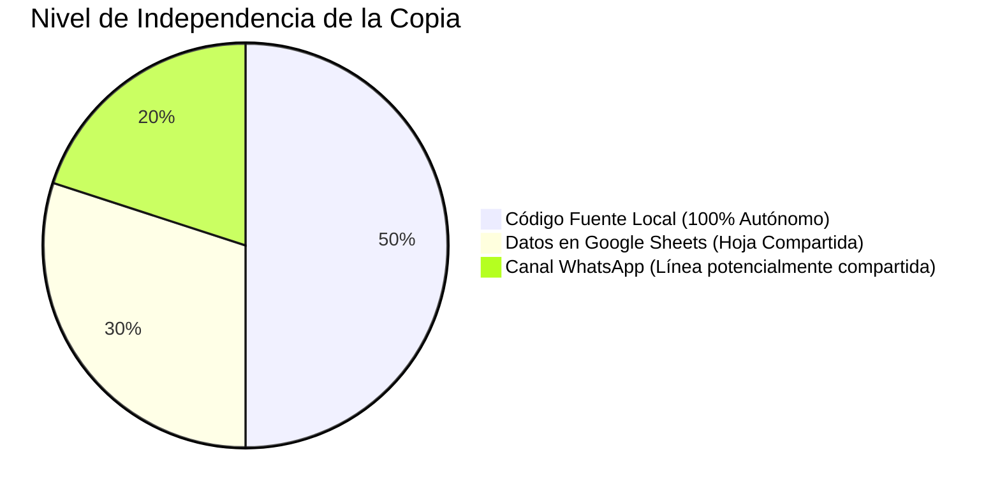

# 07 — Marca, Duplicación y Dependencias del Proyecto Original

> **Archivo:** `ANALISIS-PARA-CHAT-GPT/07-MARCA-Y-DEPENDENCIAS-DEL-PROYECTO-ORIGINAL.md`  
> **Clasificación general:** CONFIRMADO EN CÓDIGO (Auditoría de duplicación)

---

## 1. Contexto de la Duplicación: La Dualidad de Marcas

El proyecto se encuentra en una situación particular producto de su historial de bifurcación:
- **Nombre del repositorio y carpeta:** `MAYORISTAS-DUNES-PARFUMS` (asociado a la marca *DUNES PARFUMS*).
- **Identidad comercial visible en pantalla:** `GL EXPRESS — Catálogo Mayorista` (asociado a la marca *GL EXPRESS*).
- **Origen funcional:** Inicialmente fue creado como un cotizador de importación minorista (*DUNES PARFUMS* con cálculo de flete, peso y margen Excel). Luego fue transformado en un catálogo mayorista PWA conectado a Google Sheets con la identidad de *GL EXPRESS*.

En el código coexisten **elementos activos de GL EXPRESS** junto con **archivos residuales, comentarios, assets y especificaciones de DUNES PARFUMS**.

---

## 2. Inventario Detallado de Elementos de Marca y Dependencias

### 2.1. Nombre Comercial Visible y Textos SEO

| Elemento | Ubicación Exacta | Marca Actual | Uso / Contexto | Afecta Funcionamiento |
| :--- | :--- | :--- | :--- | :--- |
| **Título de la Página** | `index.html:23` | `GL EXPRESS — Catálogo Mayorista` | Título de pestaña del navegador | Visual / SEO |
| **Meta Description** | `index.html:7` | `GL EXPRESS - Plataforma oficial...`| Resumen para buscadores y redes | Visual / SEO |
| **Apple Mobile App Title**| `index.html:12` | `GL EXPRESS` | Nombre al anclar en pantalla inicio iOS | Visual / PWA |
| **Título en Header** | `index.html:56` | `GL EXPRESS` | Encabezado principal de la aplicación | Visual |
| **Subtítulo en Header** | `index.html:57` | `Catálogo Mayorista 🇵🇪` | Descripción de cabecera | Visual |
| **Título en Splash** | `index.html:40-41` | `GL EXPRESS` / `CATÁLOGO MAYORISTA` | Pantalla de bienvenida | Visual |
| **Pie de Página (Footer)**| `index.html:167` | `GL EXPRESS © 2026 • Perfumería...` | Copyright inferior | Visual |
| **PWA Manifest Names** | `manifest.json:2-3` | `"name": "GL EXPRESS MAYORISTA"` `"short_name": "GL EXPRESS"` | Instalación PWA en Android/Windows | Visual / PWA |
| **Mensaje de WhatsApp** | `app.js:684` | `PEDIDO MAYORISTA GL EXPRESS` | Encabezado del pedido enviado | **Operativo comercial** |
| **README Oficial** | `README.md:1` | `# 💎 GL EXPRESS — Catálogo Mayorista` | Documentación técnica | Documental |

### 2.2. Logotipos, Favicon e Iconos

| Archivo / Ruta | Marca Representada | Estado en el Proyecto Actual |
| :--- | :--- | :--- |
| **`logosDP/logoGL.jpeg`** | **GL EXPRESS** | **ACTIVO**: Es el logo que realmente se muestra en `index.html:38, 53` (Splash y Header). El nombre del archivo es `logoGL`, pero la carpeta se llama `logosDP` (Dunes Parfums). |
| **`assets/logohorizontaldunesparfums.webp`** | **DUNES PARFUMS** | **LEGACY / INACTIVO**: Imagen del logo horizontal de Dunes Parfums. No está referenciada en `index.html` ni en `style.css`. |
| **`assets/logocotizador.png`** | **DUNES PARFUMS** | **LEGACY / INACTIVO**: Imagen cuadrada del cotizador Dunes Parfums. No está referenciada en la UI activa. |
| **`assets/favicon-*.png`, `favicon.ico`** | **GL EXPRESS** | **ACTIVO**: Actualizados en el commit `ac15c4d` con los colores y marcos dorados de GL EXPRESS. |
| **`icons/` (carpeta completa)** | **GL EXPRESS** | **DUPLICADO**: Contiene réplicas de los favicons e iconos de `assets/`. |

### 2.3. Paleta de Colores y Estilos en `style.css`

- **En la cabecera del archivo (`style.css:1-26`):**
  - Comentario línea 2: `DUNES PARFUMS — Hoja de Estilos de Lujo`.
  - Comentario línea 8: `Paleta Oficial DUNES PARFUMS (Inspirada en el Logo Oficial de la Marca)`.
  - Comentario línea 16: `Dorados Oficiales de Marca (Extraídos del Logo DUNES PARFUMS)`.
- **En la sección mayorista (`style.css:2494-2516`):**
  - Comentario línea 2495: `GL EXPRESS — ESTILOS DEL CATÁLOGO MAYORISTA & CARRITO`.
  - Clases específicas: `.brand-gl-badge`, `.splash-logo-badge`, `.catalogo-mayorista-grid`.
- **Impacto:** Ambos proyectos comparten la misma base estética: fondo negro obsidiana cálido (`#08070a`), detalles dorados champagne (`#d4a73b`), verde esmeralda para ganancias (`#10b981`) y tipografías `Cinzel` y `Outfit`. La identidad visual fue reutilizada y adaptada con el logo de GL.

### 2.4. Datos de Contacto y Canal de Pedidos

- **Número de WhatsApp:** `51910487554` (`app.js:133`).
- **Impacto Operativo:** Este es el receptor de todos los pedidos emitidos desde el botón de checkout. Si este número pertenece al dueño de GL EXPRESS o a Dunes Parfums, ambos podrían estar recibiendo las cotizaciones en la misma línea.
- **Redes Sociales:** No hay enlaces a Instagram, Facebook ni TikTok configurados en el HTML actual.

### 2.5. Fuentes de Datos y Google Sheets

- **URL de Google Sheets en `app.js:26`:**
  `https://docs.google.com/spreadsheets/d/e/2PACX-1vSMxWTEsUiAmYSnu8ra29ku79UTtObn2EnphEEabBODeDZDdXUVcHqI85RnXSvSHBuRthVUlbsWnCy_/pub?gid=2013926010&single=true&output=csv`
- **¿Es un recurso compartido con el proyecto original?**
  - El identificador del libro de Google Sheets (`2PACX-1vSMxWTEsUi...`) corresponde a un mismo documento maestro de Google Spreadsheets.
  - El parámetro `gid=2013926010` apunta específicamente a la pestaña llamada **`MAYORISTA`**.
  - Según el README (`README.md:11`): *"Conexión Exclusiva Pestaña MAYORISTA: Lectura directa de la hoja de Google Sheets vía gid=2013926010 sin interferir con la versión minorista DUNES APP."*
  - **Conclusión técnica:** **La base de datos (hoja de cálculo) es compartida** con la aplicación minorista, pero segmentada por pestañas (`gid`). Cualquier cambio o alteración que se haga en esa pestaña afectará directamente a este catálogo.

### 2.6. Archivos y Documentación Huérfana del Proyecto Original

Los siguientes archivos pertenecen a la versión original de Dunes Parfums y no tienen ningún efecto en la ejecución del catálogo actual:

1. **`js/calculator.js`:** Motor matemático de importación ("DUNES PARFUMS - Motor de Cálculo de Importación"). No es cargado por `index.html` ni por `app.js`.
2. **`scripts/generate_icons.py`:** Generador de iconos con mensaje final: `"Todos los iconos de DUNES PARFUMS fueron generados con éxito a partir de logocotizador.jpeg."`.
3. **`tests/calculator.test.js`:** Pruebas del archivo `js/calculator.js`.
4. **`tests/validate-app.js`:** Validador del DOM de la antigua app de cotización retail.
5. **`tests/sheets.test.js`:** Validador del antiguo formato CSV de 11 columnas.
6. **`docs/superpowers/plans/2026-09-05-dunes-parfums-app.md`** y **`docs/superpowers/specs/2026-09-05-dunes-parfums-design.md`**: Especificaciones y planes de la versión previa.

---

## 3. Estado de Independencia del Proyecto

1. **Copia Independiente del Código (CONFIRMADO):**
   - El código fuente en `c:\Users\Lucas\Desktop\MAYORISTAS-DUNES-PARFUMS` es completamente autónomo y no depende de ningún archivo local del otro proyecto.
   - Las claves de `localStorage` están aisladas (`glexpress_*`).
   - El identificador del Service Worker está aislado (`glexpress-mayorista-v3.1`).
2. **Servicios y Datos Compartidos (RIESGO IDENTIFICADO):**
   - **Google Sheets:** La hoja maestra es la misma que la de DUNES APP. Si el administrador modifica o elimina la pestaña `gid=2013926010`, esta app quedará sin catálogo dinámico.
   - **WhatsApp:** El número `51910487554` debe confirmarse si corresponde a la marca que se desea operar.
3. **Configuración Independiente Pendiente para Desacoplamiento Total:**
   - Crear una hoja de Google Sheets separada e independiente para este catálogo.
   - Actualizar el número de WhatsApp si este catálogo corresponde a otra línea de ventas.
   - Definir si el nombre comercial final será *DUNES PARFUMS MAYORISTA* o continuará como *GL EXPRESS*.
